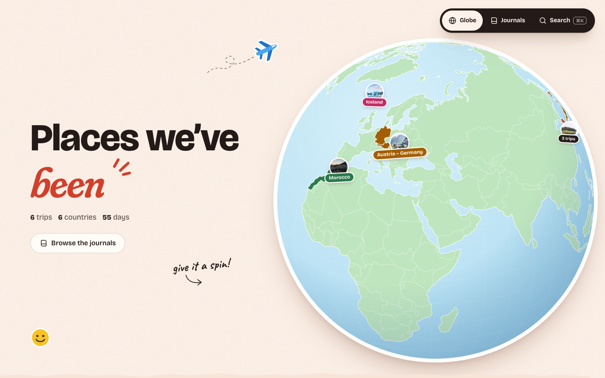
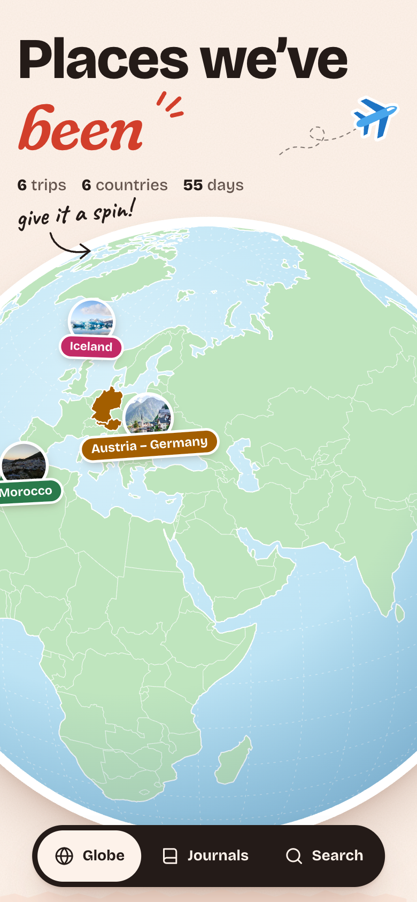
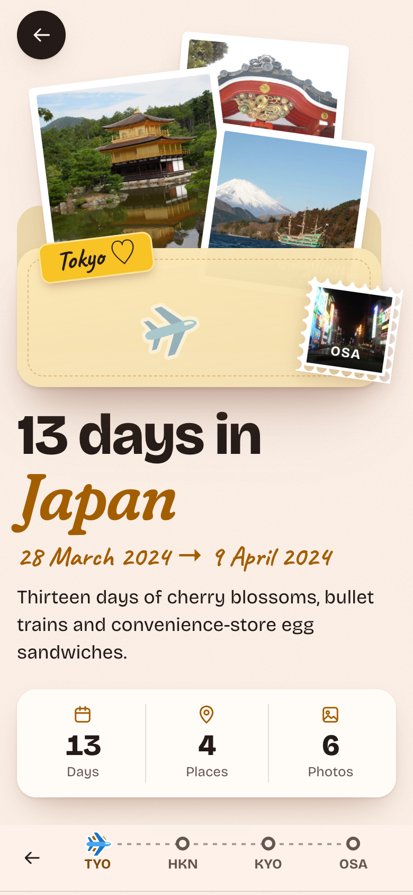

# Places We've Been

A private travel scrapbook for your family: a paper globe of every trip, with journals, stories and vlogs. You host it yourself on Cloudflare's free plan, and only the people you list can see it.



<p align="center">
  
  &nbsp;&nbsp;
  
</p>

<sub>Screenshots show the example trips from <code>npm run seed</code>.</sub>

```sh
npm install
npm run seed     # load the example trips
npm run dev      # http://localhost:4321
npm test
```

## How it works

The site runs as a Cloudflare Worker. Each page is made when someone visits, from:

- **D1** (Cloudflare's SQLite database): trips, stops and stories
- **R2** (Cloudflare's file storage): the photos, resized and with their GPS location removed

Nothing personal lives in this repository. `npm run dev` simulates D1 and R2 on your computer (in `.wrangler/`, which git ignores), so you don't need a Cloudflare account to work on the site.

## The trip editor

Open **/admin** on your site (or http://localhost:4321/admin while `npm run dev` runs). From there you can:

- start a trip (it begins as a **draft**, hidden from the site until you tick *Show on the site*)
- add, reorder and remove stops, with their story, date and map position
- drag photos onto a stop, from a phone or a computer. Each is turned upright, resized and re-drawn in your browser before it's sent, which leaves its GPS location and other hidden details behind. iPhone HEIC photos work in every browser
- star a stop's postcard photos (otherwise its first three are used) and pick the cover

Saved changes show on the site straight away. Only the people listed in `EDITORS` can open the editor; everyone else who can see the site just sees the trips.

## Example trips

`npm run seed` loads every folder in `seed/trips/` into the local database, replacing what it loaded last time. The photos are public domain (see `seed/CREDITS.md`). A trip's page URL comes from its title and year: `Jeju Island` in 2025 → `/trips/jeju-island-2025`.

```
seed/trips/
  jeju-2025/
    index.md                ← the trip details + story
    photos/
      jeju-city/            ← one folder per stop, named after the stop
        IMG_4821.jpg        ← drop in as many photos as you like, any names
      seongsan-ilchulbong/
      seogwipo/
```

1. Copy an existing trip folder and rename it, e.g. `vietnam-2026`.
2. In its `photos/` folder, make one folder per stop and drag that stop's photos in. Normal phone photos are fine; `npm run seed` resizes and compresses them.
3. Edit `index.md`, then run `npm run seed`:

```yaml
---
title: Vietnam                    # shown on the globe and the postcard
startDate: 2026-06-01
endDate: 2026-06-12
countries: [VN]                   # two-letter country codes: https://en.wikipedia.org/wiki/ISO_3166-1_alpha-2
summary: One or two sentences about the trip.
cover: ./photos/ha-long/IMG_0042.jpg  # big photo at the top of the trip page
vlog: https://youtu.be/xxxxxxxxxxx  # optional
stops:                            # in the order you travelled
  - name: Hanoi
    code: HAN                     # short code for the postcard stamp (max 4 letters)
    lat: 21.03                    # in Google Maps: right-click a place → click the numbers to copy them
    lng: 105.85                   #   (Google gives "lat, lng" — the first number is lat)
    date: 2026-06-01
    story: A few sentences for the postcard.
    photos: [./photos/hanoi/IMG_0001.jpg, ./photos/hanoi/IMG_0007.jpg]  # 2–3 favourites for the globe postcard
---

The long story goes here, below the dashes. Write as much as you like.
```

### Photos on the trip page

The postcard on the globe only shows the few photos listed under `photos:`. The trip page ("Open the journal") shows **every** photo in the stop's folder as a photo wall, plus a full-screen viewer that steps through the whole trip in order.

- **Folder names** are the stop name in lowercase, with spaces turned into dashes and accents removed: `Seongsan Ilchulbong` → `seongsan-ilchulbong`, `Reykjavík` → `reykjavik`. A folder that doesn't match any stop is skipped.
- **Order** comes from the date the camera saved in each photo, so photos from different phones mix correctly. If a stop spans several days, the page adds "Day 2 · Fri 19" labels. Photos without a date (screenshots, photos sent over WhatsApp) go at the end of the stop, sorted by filename.
- **iPhone HEIC photos** need to be JPEG. AirDrop to a Mac usually converts them, or set the iPhone to Settings → Camera → Formats → Most Compatible.

If something is missing or mistyped (a wrong country code, an end date before the start), `npm run seed` stops with a message saying what's wrong.

**Visiting the same country more than once** is fine: make a separate trip for each visit (e.g. `seoul-busan-2023` and `jeju-2025`). Each one gets its own route on the globe. When their labels would overlap, they merge into one label ("South Korea · 2 trips") that lets you choose.

## Deploying

The site runs on Cloudflare's free plan. You'll need a Cloudflare account and your copy of this repository on GitHub.

### 1. Create the database and photo storage

First turn on R2 once for your account: in the Cloudflare dashboard, open **R2 Object Storage** and follow the prompts. Cloudflare may ask for a payment method even for the free tier (10 GB). Then:

```sh
npx wrangler login
npx wrangler d1 create places-weve-been
npx wrangler r2 bucket create places-weve-been-photos
```

`d1 create` prints a `database_id`. Add it to the `d1_databases` entry in `wrangler.jsonc`:

```jsonc
"d1_databases": [{ "binding": "DB", "database_name": "places-weve-been", "database_id": "<the id it printed>", "migrations_dir": "migrations" }]
```

The bucket stays private: photos only ever go out through the site, which checks who's asking.

### 2. Put the site online

In the Cloudflare dashboard: **Workers & Pages → Create → Import a repository**, pick your repository, and set:

- Build command: `npm run build`
- Deploy command: `npm run deploy`

`npm run deploy` brings the database up to date (`migrations/`) and then publishes the site. From then on, every push to `main` deploys by itself.

Until you finish step 3 the site answers *"isn't set up for signing in yet"*. That's on purpose: nothing is shown until it knows who's looking.

### 3. Let only your family in (Cloudflare Access)

1. **Zero Trust** (left menu) → pick a team name → choose the **Free** plan (up to 50 people).
2. **Access → Applications → Add an application → Self-hosted.** Add your site's address (your own domain, or the `….workers.dev` one). Apply it to the whole site.
3. Add a policy: **Action: Allow**, **Include → Emails**, and list everyone who may see the site. (Use *Emails*, not *Emails ending in*: `@gmail.com` would let in every Gmail user.)
4. Login method: **One-time PIN**. Family get a code by email; no accounts or passwords.
5. Note two things: your **team domain** (Zero Trust → Settings, e.g. `yourfamily.cloudflareaccess.com`) and the application's **Application Audience (AUD) Tag** (on the application's overview).

Then tell the site, from this folder:

```sh
npx wrangler secret put ACCESS_TEAM_DOMAIN   # yourfamily.cloudflareaccess.com
npx wrangler secret put ACCESS_AUD           # the AUD tag
npx wrangler secret put EDITORS              # who may use /admin, e.g. you@example.com,partner@example.com
```

The site checks the signed token Access attaches to every visit, so someone who finds a way around Access (for example the `workers.dev` address, if you only protected your own domain) still gets nothing. To be tidy, you can also turn that address off: the Worker → **Settings → Domains & Routes**.

**Check it:** open the site in a private window. You should get Cloudflare's sign-in page, not the globe. Sign in, then open `/admin`.

**Adding someone later:** edit the Access policy's email list. To let them edit too, run `npx wrangler secret put EDITORS` again with the longer list.

### Other ways to keep it private

| | Cost | What family do | Notes |
|---|---|---|---|
| **Cloudflare Access** (above) | Free up to 50 people | Type their email, get a code | Recommended |
| **Public** | Free | Nothing | Run `npx wrangler secret put PUBLIC_SITE` with `true` and anyone with the link sees the trips. The editor still needs Access |
| **Tailscale** | Free | Install an app | Very private, more setup for each person. Suits a home server more than Cloudflare |

## Backups

Your trips and photos live only on Cloudflare, not in this repository, so keep your own copy:

```sh
npm run backup                           # into ./backups (git ignores it)
npm run backup -- --to ~/Dropbox/atlas   # or somewhere safer: a synced folder or external drive
```

Run it after adding trips. It only reads from Cloudflare and only downloads photos it doesn't have yet. It needs `npx wrangler login`. Each run adds a dated folder with `backup.json` and `database.sql` (plain SQL any SQLite tool can read); the `photos` folder next to them is shared. These are the resized photos the site uses, so keep your originals too.

To look at a backup, restore it into the local simulation and run `npm run dev`. This doesn't touch your live site:

```sh
npm run restore -- backups/2026-11-06-1430
```

If you ever need to put a backup back online, add `--remote`. It **replaces everything on your live site**, shows you what's there now and asks you to type `replace` first. Try the backup locally before you do.

## Project layout

| Path | What it is |
|---|---|
| `src/schema/tables.ts` | The database tables: the one place the shape of a trip is defined |
| `src/schema/trip.ts` | What the editor may save, and the messages it shows when something's wrong (Zod) |
| `src/server/stores/` | Where trips are kept: D1 on Cloudflare, or a SQLite file (Docker, tests) |
| `src/server/photos/` | Where photo files are kept: R2 on Cloudflare, or a folder (Docker, tests) |
| `src/server/auth/` | Who is looking at the site: Cloudflare Access, or a local stand-in for `npm run dev` |
| `src/server/runtime.ts` | Which stores and sign-in this deployment uses |
| `src/middleware.ts` | Who may see the site and who may edit, checked on every request |
| `src/pages/` | The globe and journals (`index.astro`), the trip pages and the photo files (`photos/`) |
| `src/components/` | Home page (`GlobeExplorer.tsx`, `TripSheet.tsx`, `Journals.tsx`, `SearchPalette.tsx`), the trip page's parts (`journal/`) and the stickers (`StickerSprite.astro`) |
| `src/lib/globe/engine.ts` | The globe itself (d3-geo, SVG) |
| `src/lib/journal/` | The trip page's photo walls, route map, viewer and scroll progress |
| `src/lib/ink.ts` | The colour each trip writes in |
| `src/admin/` | The trip editor at `/admin`; `prepare-photo.ts` resizes photos in the browser |
| `src/pages/admin/api/` | What the editor saves through |
| `src/styles/` | Colours, fonts and shared pieces (`tokens.css`), the home page (`home.css`), the trip page (`journal.css`) |
| `migrations/` | Database changes. After changing `tables.ts`, run `npm run db:generate <name>` |
| `scripts/` | `npm run seed`, `npm run backup`, `npm run restore` |
| `seed/trips/` | The example trips, loaded by `npm run seed` |
| `tests/` | `npm test` |

## Licence

MIT: see [`LICENSE`](LICENSE). The example photos are public domain ([`seed/CREDITS.md`](seed/CREDITS.md)). Found a way past the sign-in, or a photo that keeps its location? Please see [`SECURITY.md`](SECURITY.md) rather than opening an issue.
